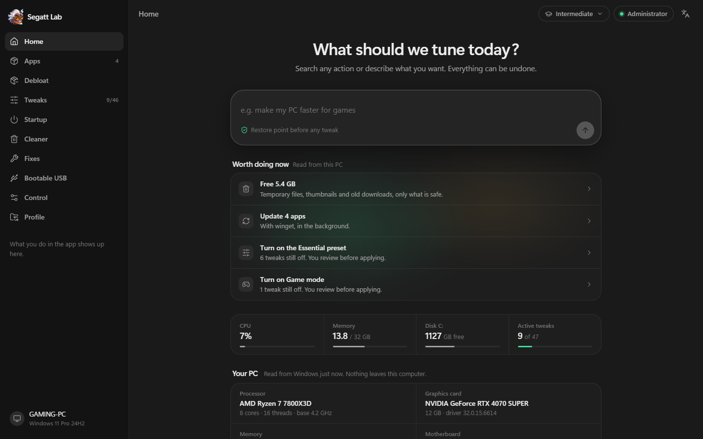
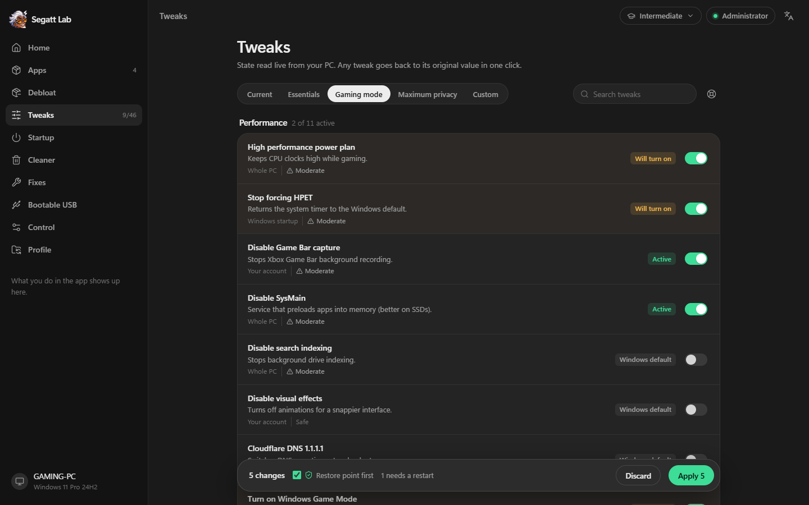
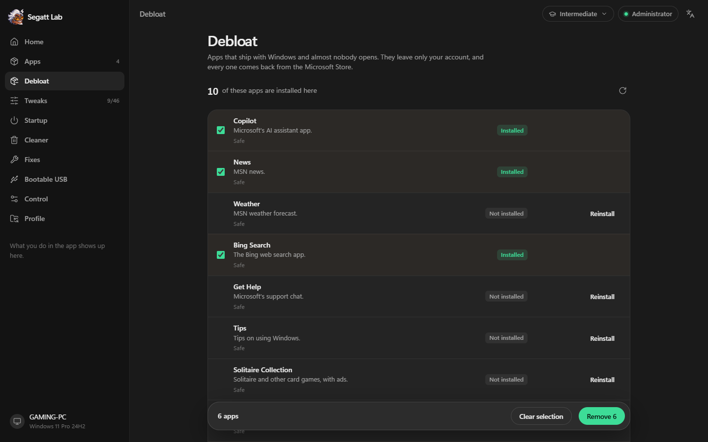
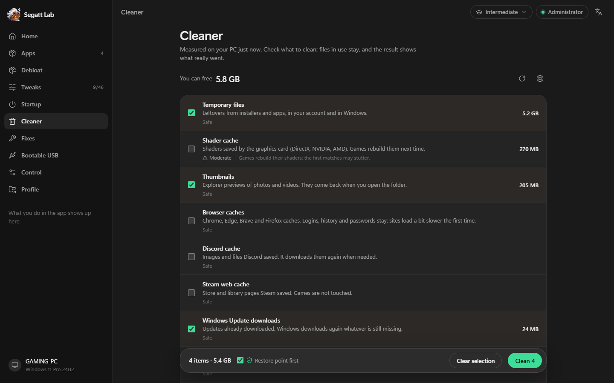
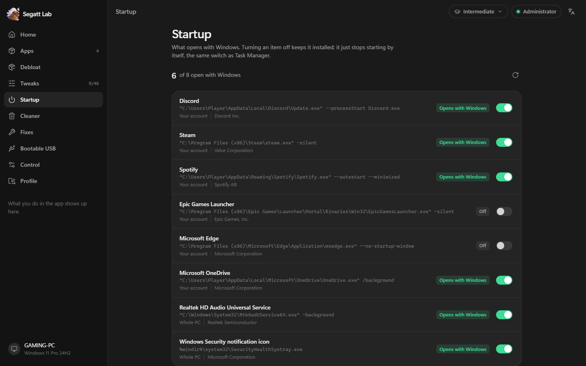
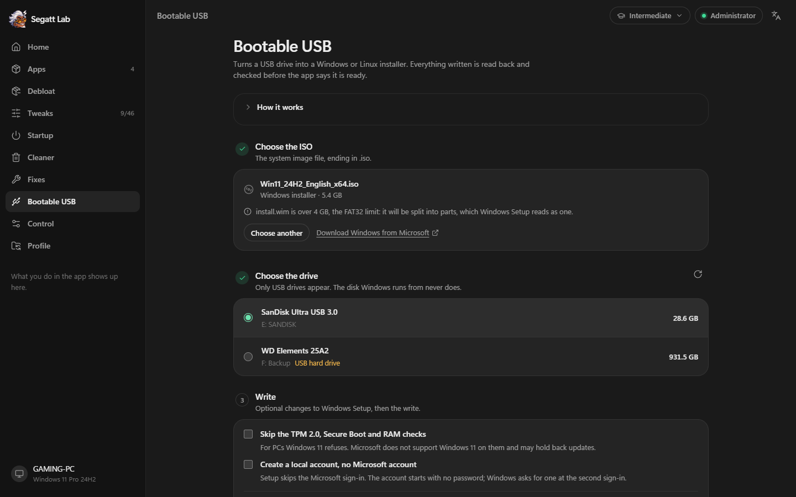
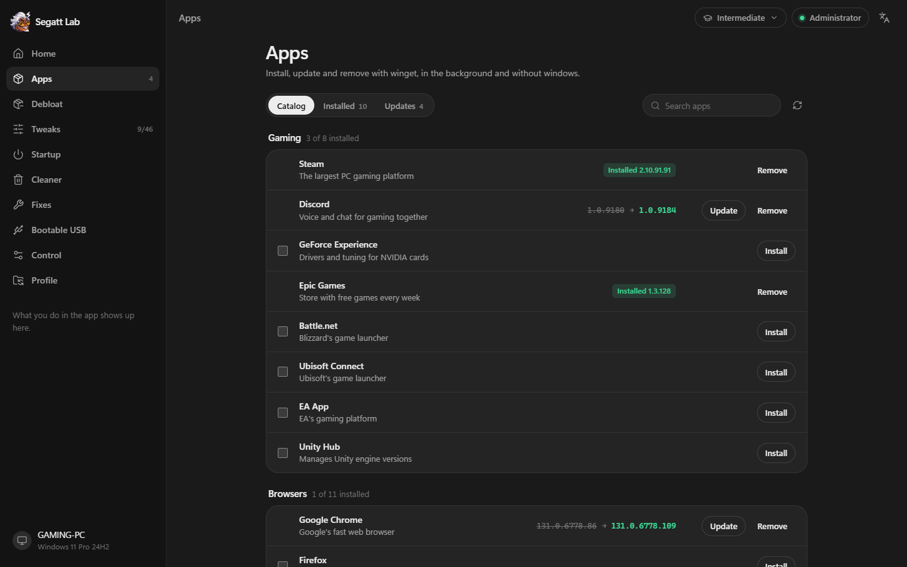

<div align="center">


# Segatt Lab

**Tune, debloat, clean and repair Windows 10 and 11 from one native app.**<br>
It reads your PC's real state first, shows you what will change, and every tweak goes back to its original value in one click.

[](https://github.com/joshsegatt/Segatt-Tools/releases/latest)
[](https://github.com/joshsegatt/Segatt-Tools/actions/workflows/ci.yml)
[](LICENSE)


[Download](https://github.com/joshsegatt/Segatt-Tools/releases/latest) · [Website](https://joshsegatt.github.io/Segatt-Tools/) · [Features](#features) · [Safety](#how-it-keeps-your-pc-safe) · [FAQ](#faq)



</div>

## Install

Open **PowerShell** and run:

```powershell
irm https://raw.githubusercontent.com/joshsegatt/Segatt-Tools/main/install.ps1 | iex
```

The script downloads the latest installer from GitHub Releases, checks its SHA-256 against the one GitHub publishes, and runs it. [Read it first](install.ps1) if you like; it is 28 lines.

Or download the `.exe` or `.msi` from [Releases](https://github.com/joshsegatt/Segatt-Tools/releases/latest) yourself.

## Why Segatt Lab

- **It shows before it changes.** Every tweak displays its live state on your PC, read from the registry, services and power settings, not a guess.
- **Everything can be undone.** The original value is saved before a change, and a restore point is made first. Risky items always ask.
- **One app, no console windows.** Installs, cleanups and repairs run in the background with real progress and a real result: "Freed 5.4 GB", not "Done".
- **Nothing leaves your PC.** No account, no telemetry, no cloud. Hardware details stay on the machine.
- **It meets you at your level.** Pick Beginner, Intermediate or Advanced; the app shows only what fits, and never hides what is already on.

## Features

### Tweaks: 47, each with its live state and one-click undo

Privacy, performance, interface, system and Windows services. Three presets (Essentials, Gaming, Maximum privacy) are tuned to your hardware: a laptop never gets the power settings meant for a desktop, and a hard drive keeps SysMain.



### Debloat: remove the apps Windows ships with, and get any of them back

Copilot, News, Bing Search, Solitaire, the Xbox Game Bar, Teams, OneDrive and more, 22 in all. Each one comes back from the Microsoft Store with one click.



### Cleaner: measured on your PC before you clean

13 cleanups: temporary files, Windows Update downloads, Prefetch, the DNS cache, shader caches, thumbnails, Delivery Optimization, logs and dumps, Windows.old, the Recycle Bin, and the caches of Chrome, Edge, Brave, Firefox, Discord and Steam. Logins, history and passwords are never touched.



### Startup: see what opens with Windows and switch it off

The same switch as Task Manager, with friendly names and publishers, for your account and for the whole PC.



### Bootable USB: a lean Rufus built in

Windows 10/11 or Linux on a USB drive in three guided steps. Optionally skip the TPM, Secure Boot and RAM checks, or create a local account with no Microsoft sign-in. Only USB drives are listed, you type the drive's name to confirm, and everything written is read back and compared before it says **Ready and verified**.



### Apps: install and update with winget, in the background

42 hand-picked apps in five categories, the whole winget catalog in search, and **Update all** for what is outdated.



### And also

- **Fixes:** SFC and DISM with a plain-language verdict, network reset, Windows Update reset, icon cache, and the classic control panels.
- **Control:** Windows Update modes and optional Windows features.
- **Profile:** export your apps and tweaks to one file and set up a new PC from it, in the app or from the command line.
- **10 languages:** English, Português, Español, Français, Deutsch, Русский, 中文, 日本語, 한국어, Türkçe.

## How it keeps your PC safe

| | |
|---|---|
| **Risk on every item** | Safe, Moderate or Risky, with what you may notice written next to it. |
| **Restore point first** | Created before any batch of tweaks; Risky ones cannot run without it. |
| **Original values kept** | Turning a tweak off writes back exactly what was there before. |
| **Read back after writing** | A tweak counts as applied only when Windows reports the new value; a change Windows did not keep is rolled back. |
| **Real results** | Errors say what failed and why. A task that failed never shows as done. |
| **Open source** | MIT license. Every check and script is in this repository. |

## Command line

Apply a profile with no window, for example on a freshly installed PC:

```powershell
$app = Get-ChildItem "$env:LOCALAPPDATA\Segatt Lab", "$env:ProgramFiles\Segatt Lab" -Filter *.exe -ErrorAction SilentlyContinue |
  Where-Object Name -NotMatch 'uninstall' | Select-Object -First 1
Start-Process $app.FullName -ArgumentList '--profile', '"C:\Users\you\Documents\Segatt Lab\segatt-lab-2026-11-22.json"' -Wait
```

It makes the Profile screen's default choices: a restore point first, Risky tweaks and tweaks that do not fit the hardware left out, and only missing apps installed. The result is written to `%APPDATA%\com.segatt.tools\profile-run.log`. Exit codes: `0` done, `1` something failed, `2` the file or the arguments are wrong.

## FAQ

**Windows SmartScreen warns me. Is it safe?**
SmartScreen warns about any new publisher it has not seen often. The installer's SHA-256 is published with each release (the install script checks it for you), and all the code is here to read.

**Does it need administrator?**
Yes. Tweaks for the whole PC, services, cleanup of system folders, repairs and writing USB drives all need it, so the app asks once when it opens.

**Does it send anything anywhere?**
No. There is no telemetry, no account and no cloud call. The only network use is winget downloading the apps you ask for.

**Can I undo everything?**
Every tweak, yes, to its original value. Removed apps come back from the Microsoft Store. Cleanup deletes files, so it only offers caches and leftovers that Windows and apps rebuild by themselves.

**Windows 10?**
Yes, Windows 10 and 11.

## Build from source

```bash
# Node 22.6+, Rust stable, the Tauri prerequisites for Windows
git clone https://github.com/joshsegatt/Segatt-Tools.git
cd Segatt-Tools
npm ci
npm run tauri build
```

Checks: `npx tsc --noEmit`, `npm run lint`, `npm test`, and `cargo clippy` / `cargo test` in `src-tauri`. CI runs all of them on every push.

Built with Tauri 2 and Rust, and a Next.js 16 + React 19 interface.

## License

[MIT](LICENSE) © Josh Segatt
